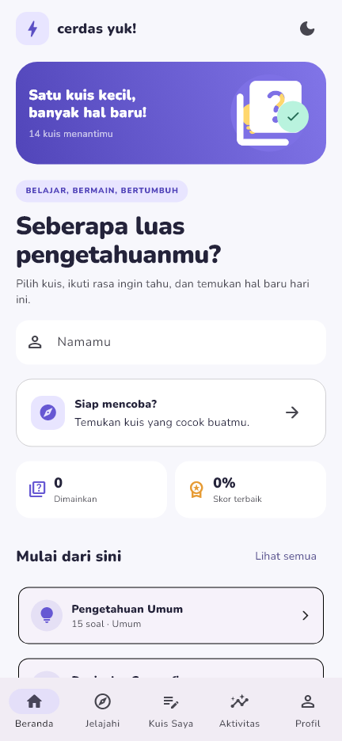
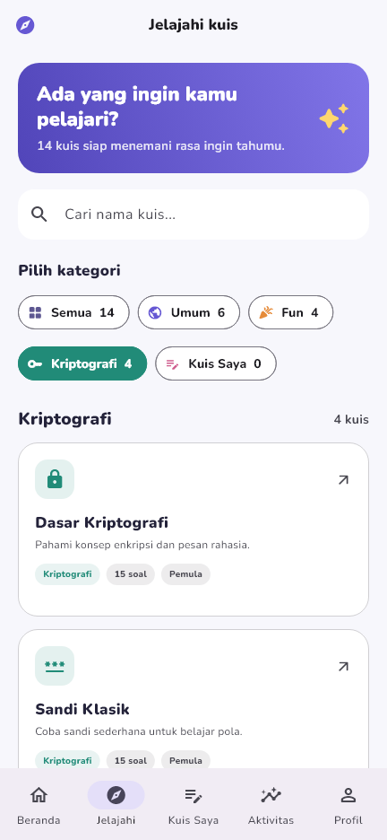
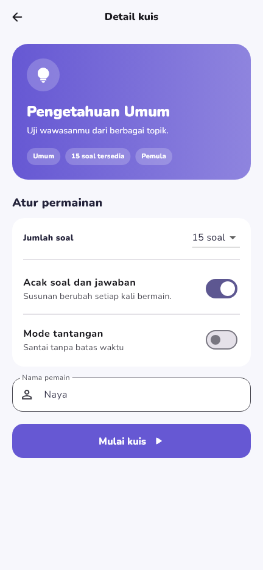
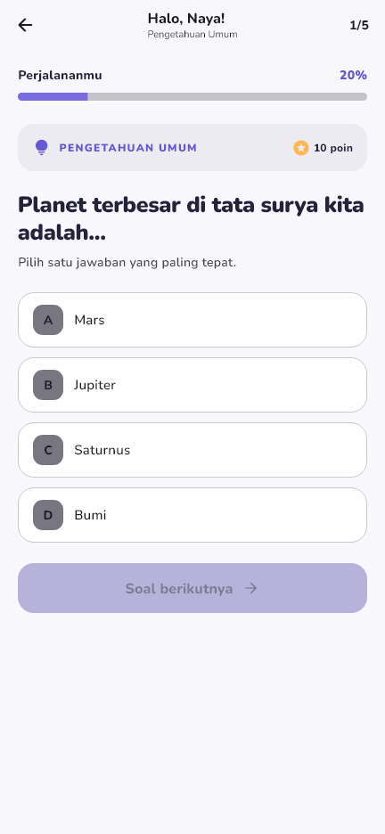
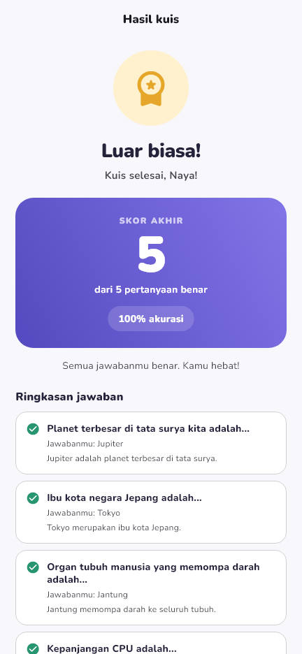
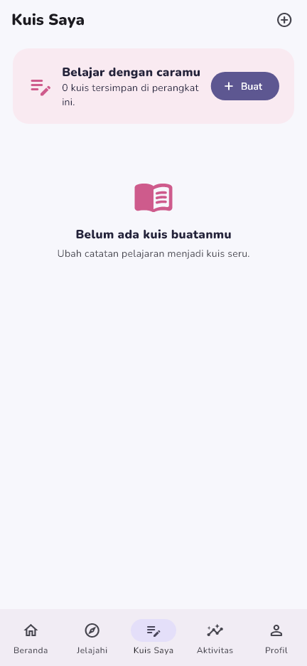
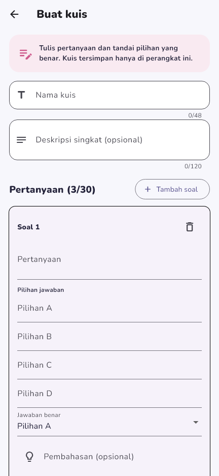
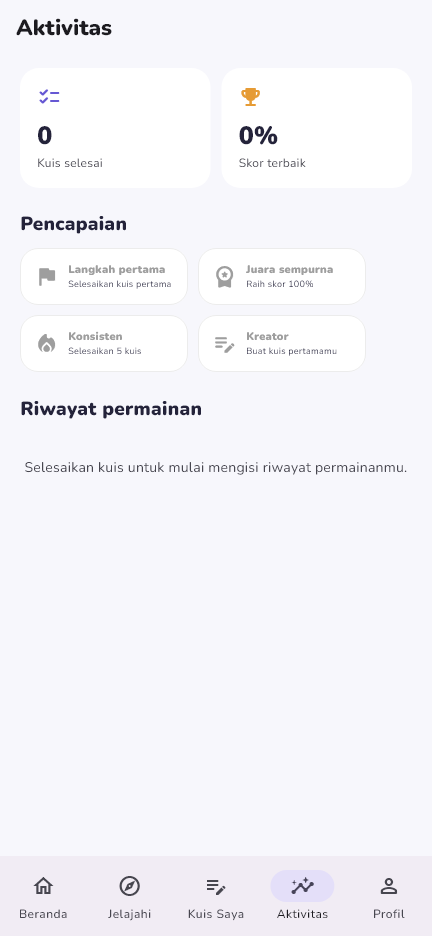
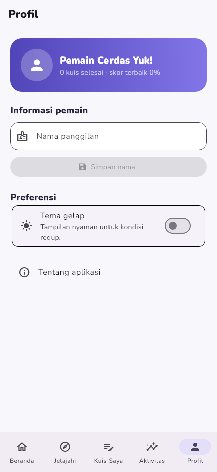

# Cerdas Yuk!

Aplikasi kuis pilihan ganda responsif yang mengajak pemain belajar lewat
pertanyaan pengetahuan umum, fakta menyenangkan, dan dasar-dasar kriptografi.

## Identitas Mahasiswa

| Informasi | Keterangan |
| --- | --- |
| Nama | Muhammad Adli Humaidi |
| NIM | 241401103 |
| Lab | Lab 5 |

## Informasi Aplikasi

**Nama aplikasi:** Cerdas Yuk!

**Deskripsi:** Aplikasi kuis Flutter untuk belajar lewat bank soal bawaan
maupun kuis yang dibuat sendiri. Data profil, kuis buatan, progres, dan riwayat
permainan disimpan secara lokal di perangkat.

**Fitur yang tersedia:**

- 14 kuis bawaan dengan total 210 soal (minimal 15 per kuis) dalam kategori
  Umum, Fun, dan Kriptografi.
- Pencarian judul dan deskripsi kuis, serta filter berdasarkan kategori.
- Pembuatan, pengubahan, dan penghapusan kuis pribadi (3–30 pertanyaan).
- Pengaturan jumlah soal, pengacakan soal dan jawaban, serta mode tantangan
  dengan timer.
- Progres kuis yang tersimpan dan dapat dilanjutkan.
- Skor akhir, persentase akurasi, ulasan jawaban, dan penjelasan.
- Riwayat aktivitas, statistik, dan pencapaian.
- Profil pemain, tema terang/gelap, tampilan responsif, ikon, serta font kustom
  Nunito.
- Penyimpanan lokal; tidak memerlukan akun atau koneksi ke backend.

## Dokumentasi Aplikasi

### Screenshot

| Halaman | Screenshot |
| --- | --- |
| Beranda |  |
| Jelajahi dan kategori |  |
| Detail kuis |  |
| Permainan |  |
| Hasil |  |
| Kuis Saya |  |
| Editor kuis |  |
| Aktivitas |  |
| Profil |  |


### Kredit aset

- **Font Nunito:** The Nunito Project Authors melalui [Google Fonts](https://github.com/google/fonts/tree/main/ofl/nunito). Font disertakan secara lokal; lisensi SIL Open Font License 1.1 tersedia di [assets/fonts/OFL.txt](assets/fonts/OFL.txt).
- **Ikon dan ilustrasi:** Material Icons dari [Flutter Material library](https://api.flutter.dev/flutter/material/Icons-class.html). Ilustrasi beranda disusun di dalam aplikasi menggunakan ikon tersebut; tidak ada gambar eksternal.


## Menjalankan Aplikasi

```sh
flutter pub get
flutter run
```

## Menjalankan Tes

```sh
flutter test
```
