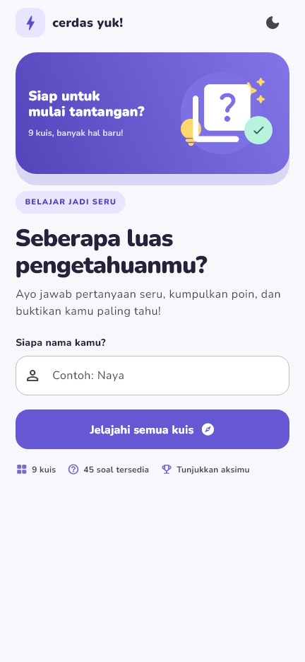
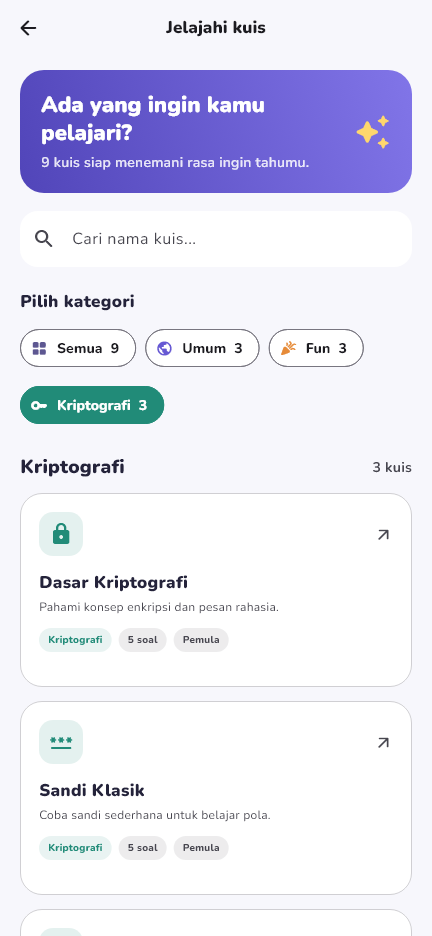
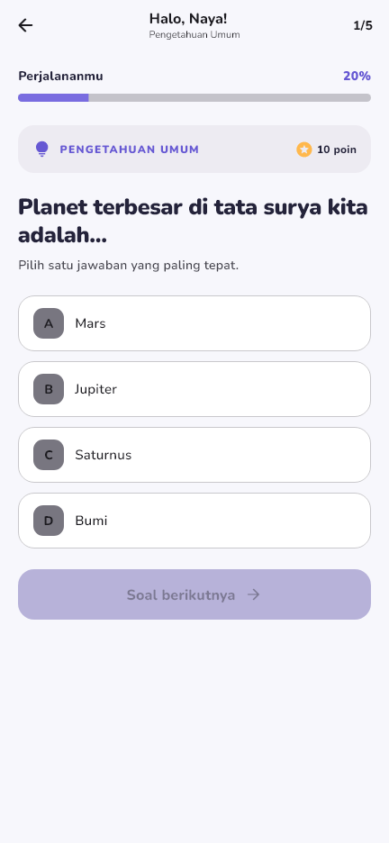
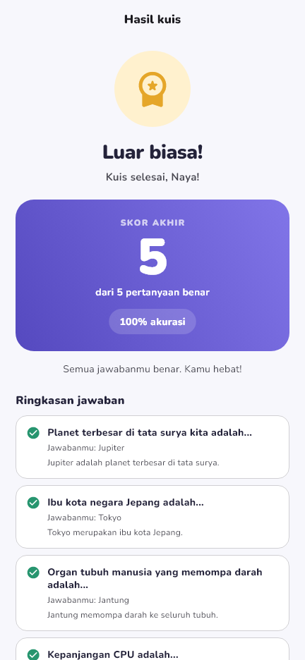

# Cerdas Yuk!

Aplikasi kuis pilihan ganda responsif yang mengajak pemain belajar lewat
pertanyaan pengetahuan umum, fakta menyenangkan, dan dasar-dasar kriptografi.

## Identitas Mahasiswa

| Informasi | Keterangan |
| --- | --- |
| Nama | ... |
| NIM | ... |
| Lab | Lab 5 |

## Informasi Aplikasi

**Nama aplikasi:** Cerdas Yuk!

**Deskripsi:** Aplikasi kuis Flutter dengan katalog kuis lokal, pencarian,
pemilihan kategori, skor langsung, dan pembahasan jawaban. Progres kuis
dipertahankan ketika pemain berpindah halaman atau memutar perangkat.

**Fitur yang tersedia:**

- Sembilan pilihan kuis dengan total 45 soal dalam kategori Umum, Fun, dan
  Kriptografi.
- Pencarian judul dan deskripsi kuis, serta filter berdasarkan kategori.
- Kuis pilihan ganda dengan indikator progres dan navigasi soal.
- Skor akhir, persentase akurasi, ulasan jawaban, dan penjelasan.
- Peringatan sebelum kuis lain menggantikan progres yang sedang berjalan.
- Tampilan responsif, tema terang/gelap, ikon, dan font kustom Nunito.
- Data kuis lokal; tidak memerlukan akun atau basis data.

## Dokumentasi Aplikasi

### Screenshot

| Beranda | Katalog dan kategori |
| --- | --- |
|  |  |

| Halaman kuis | Halaman hasil dan skor |
| --- | --- |
|  |  |

### Kredit aset

- **Font Nunito:** The Nunito Project Authors melalui [Google Fonts](https://github.com/google/fonts/tree/main/ofl/nunito). Font disertakan secara lokal; lisensi SIL Open Font License 1.1 tersedia di [assets/fonts/OFL.txt](assets/fonts/OFL.txt).
- **Ikon dan ilustrasi:** Material Icons dari [Flutter Material library](https://api.flutter.dev/flutter/material/Icons-class.html). Ilustrasi beranda disusun di dalam aplikasi menggunakan ikon tersebut; tidak ada gambar eksternal.

### Mockup / Prototype

Masih dalam proses.

## Menjalankan Aplikasi

```sh
flutter pub get
flutter run
```

## Menjalankan Tes

```sh
flutter test
```
